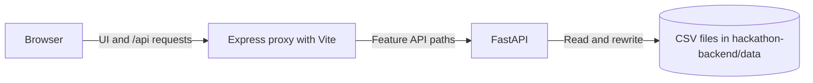

# Quality Matrix

Quality Matrix is a React application and FastAPI API for product information,
solution tracking, PYPCS quality submissions, action items, and chat. The API
uses CSV files in `hackathon-backend/data`; the settings catalog can optionally
use PostgreSQL when explicitly enabled. The browser reaches it through the
frontend's Express proxy.

## Repository Layout

```text
TheMatrix/
|-- docker-compose.yaml       # Container service and port configuration
|-- hackathon-backend/        # FastAPI application, configuration, and CSV data
|-- hackathon-frontend/       # React/Vite client and Express API proxy
`-- README.md                 # Project setup and architecture
```

The backend's `app/routers` defines API endpoints, and `app/services` contains
feature logic. The frontend separates its React code in `src/client` from its
Express proxy in `src/server`.

## Architecture



Express listens on port 5173 in local development. The frontend proxy target
uses `DJANGO_BASE_URL` as its environment-variable name, but the target service
is this FastAPI backend on port 8004.

The frontend instructions describe a Django target and say `forwardRequest`
adds `/api`; current code mounts `/api` in Express and appends the supplied
backend path directly to the configured base URL.

## Prerequisites

- Python 3.12+.
- Node.js LTS and npm. `package.json` does not specify a Node engine version.
- Windows PowerShell for the commands below.

## Run locally (Windows)

### First-time setup

```powershell
cd hackathon-backend
py -3.12 -m venv .venv
# If `py -3.12` is unavailable, use: python -m venv .venv
.\.venv\Scripts\python.exe -m pip install -r requirements.txt
```

Install frontend dependencies and create `hackathon-frontend/.env.development`
with the variable names `PORT`, `NODE_ENV`, `DJANGO_BASE_URL`, and
`VITE_ENCRYPTION_KEY`. Set `DJANGO_BASE_URL` to the backend URL, normally
`http://127.0.0.1:8004`. Keep any encryption key value private.

```powershell
cd ..\hackathon-frontend
npm install
```

### Every time

Start the backend in the first PowerShell terminal. The local data override
keeps UI edits in `hackathon-backend/data`; without it, the backend uses the
team network share configured in `.env.production`.

```powershell
cd hackathon-backend
$env:QUALITY_MATRIX_DATA_DIR = "data"
.\.venv\Scripts\python.exe -m uvicorn main:app --reload --port 8004
```

Start the frontend in a second terminal:

```powershell
cd hackathon-frontend
npm run dev
```

### Verify

- Backend health: [http://127.0.0.1:8004/health](http://127.0.0.1:8004/health)
- API docs: [http://127.0.0.1:8004/docs](http://127.0.0.1:8004/docs)
- UI: [http://localhost:5173](http://localhost:5173)

If PowerShell's `Invoke-WebRequest` reports a proxy error for localhost, test
with `curl.exe --noproxy "*" http://127.0.0.1:8004/health`.

### Docker Compose

Compose declares frontend port 8005 and backend port 8004. It is not buildable
from this checkout as-is: the frontend Dockerfile referenced by Compose is
absent, and the backend Dockerfile copies an `intel-ca.crt` that is absent.
The backend data mount is also configured as `/mnt/x/Quality:/app/data`, which
is environment-specific and needs a suitable host path on Windows.

## Configuration

| Variable                                                     | File or source                                                                      | Purpose                                                                                                                                                                                                 |
| ------------------------------------------------------------ | ----------------------------------------------------------------------------------- | ------------------------------------------------------------------------------------------------------------------------------------------------------------------------------------------------------- |
| `PORT`                                                     | Frontend `.env.development`                                                       | Express listen port; local setting is 5173.                                                                                                                                                             |
| `DJANGO_BASE_URL`                                          | Frontend `.env.development`                                                       | FastAPI base URL; local setting is `http://127.0.0.1:8004`. The name is legacy.                                                                                                                       |
| `NODE_ENV`                                                 | Frontend `.env.development` / npm script                                          | Selects development or production mode and env file.                                                                                                                                                    |
| `SESSION_SECRET`                                           | Frontend `.env.development` / process environment                                 | Signs the `qm_session` cookie; keep the value private and use a random secret.                                                                                                                        |
| `PROXY_SHARED_SECRET`                                      | Frontend `.env.development` and backend `.env.production` / process environment | Must match between Express and FastAPI; keep the value private and use a random secret.                                                                                                                 |
| `SESSION_COOKIE_SECURE`                                    | Frontend `.env.development` / process environment                                 | Set to `true` only when Express is served over HTTPS; unset/false for the current HTTP setup.                                                                                                         |
| `VITE_ENCRYPTION_KEY`                                      | Frontend `.env.development`                                                       | Loaded into server config; keep any value private.                                                                                                                                                      |
| `VITE_API_BASE_URL`                                        | Frontend `.env.development`                                                       | Present in the env file; no consumer was found in current source.                                                                                                                                       |
| `VITE_OLB_PROFILE_URL`                                     | Frontend `.env.development` (optional)                                            | Browser-side OLB+ identity URL; defaults to `https://olbplus.intel.com:3386/fetch_profile`. OLB+ must allow the app origin via CORS.                                                                  |
| `VITE_OLB_PROFILE_METHOD`                                  | Frontend `.env.development` (optional)                                            | Browser-side OLB+ identity method; defaults to `GET`.                                                                                                                                                 |
| `VITE_OLB_LOGIN_ENABLED`                                   | Frontend `.env.development` (optional)                                            | Enables OLB+ sign-in only when set to `true`; defaults to off and shows the manual form.                                                                                                              |
| `QUALITY_MATRIX_DATA_DIR`                                  | Backend `.env.production` or shell                                                | `.env.production` sets the team network share location. Defaults to `data`; for local data, set `$env:QUALITY_MATRIX_DATA_DIR = "data"` in the backend PowerShell window before starting Uvicorn. |
| `ALLOWED_ORIGINS`                                          | Backend environment                                                                 | Comma-separated browser origins; defaults include ports 5173 and 3000.                                                                                                                                  |
| `DATABASE_URL`                                             | Backend `.env.local` or process environment                                       | SQLAlchemy URL. It selects the settings database only when `QUALITY_MATRIX_DB_FEATURES=settings`; shell values override dotenv files.                                                                 |
| `QUALITY_MATRIX_DB_FEATURES`                               | Backend `.env.local` or process environment                                       | Comma-separated DB features. Currently only `settings` is supported; requires `DATABASE_URL`. Unlisted features remain CSV-backed.                                                                  |
| `POSTGRES_DB`, `POSTGRES_USER`, `POSTGRES_PASSWORD`    | Compose interpolation environment                                                   | Credentials/database name for the local `quality-matrix-db` service; supply values outside tracked files.                                                                                             |
| `NYRA_API_KEY`                                             | Backend `.env.production`                                                         | Required by the chat endpoint; secret.                                                                                                                                                                  |
| `NYRA_CHAT_MODEL`                                          | Backend `.env.production`                                                         | Optional chat model override; code default is `gpt-5.4-mini`.                                                                                                                                         |
| `HTTP_PROXY`, `HTTPS_PROXY`, `FTP_PROXY`, `NO_PROXY` | Root `.env.production`                                                            | Optional proxy settings passed to the Compose builds and containers.                                                                                                                                    |

The frontend env file also contains `VITE_ENCRYPTION_KEY`; do not put its value
in documentation or commit sensitive values. The frontend and backend env files
are gitignored; configure both auth secrets there for local development, using
the same `PROXY_SHARED_SECRET` value in each. Compose reads the root
`.env.production`, which is separate from the backend's `.env.production`.

### Settings Database (Local)

The local, gitignored `hackathon-backend/.env.local` enables PostgreSQL settings
only when both `DATABASE_URL` is set and `QUALITY_MATRIX_DB_FEATURES=settings`.
It is excluded from the Docker build context. `POSTGRES_DB`, `POSTGRES_USER`,
and `POSTGRES_PASSWORD` in the root `.env` configure Compose. Start PostgreSQL
and initialize it from local CSV data:

```powershell
docker compose up -d quality-matrix-db
cd hackathon-backend
$env:QUALITY_MATRIX_DATA_DIR = "data"
.\.venv\Scripts\python.exe -m alembic upgrade head
\.venv\Scripts\python.exe scripts\import_csv_to_db.py --data-dir data --apply --replace
.\.venv\Scripts\python.exe -m uvicorn main:app --reload --port 8004
```

To return to CSV mode, remove `QUALITY_MATRIX_DB_FEATURES` from
`hackathon-backend/.env.local` (or set `$env:QUALITY_MATRIX_DB_FEATURES = ""`
for the current PowerShell process), then restart the backend. Settings writes
in DB mode are exported to CSV after each commit.

## Troubleshooting

| Symptom                                                                   | Cause                                                                              | Fix                                                                                                                                                                                                                                       |
| ------------------------------------------------------------------------- | ---------------------------------------------------------------------------------- | ----------------------------------------------------------------------------------------------------------------------------------------------------------------------------------------------------------------------------------------- |
| `Activate.ps1` is blocked                                               | PowerShell execution policy prevents script activation.                            | From `hackathon-backend`, use `.\.venv\Scripts\python.exe` directly as shown above. Or run `Set-ExecutionPolicy -Scope Process -ExecutionPolicy Bypass` in that window only, then activate.                                         |
| `python` or `uvicorn` is not found                                    | The venv is missing, or a bare command is being used.                              | From `hackathon-backend`, run `.\.venv\Scripts\python.exe -m uvicorn main:app --reload --port 8004`.                                                                                                                                  |
| `ModuleNotFoundError`                                                   | Backend requirements or frontend packages are missing.                             | Backend, from `hackathon-backend`: `.\.venv\Scripts\python.exe -m pip install -r requirements.txt`. Frontend: run `npm install` in `hackathon-frontend`.                                                                          |
| Port 8004 or 5173 is already in use                                       | Another process owns the port.                                                     | Check with `Get-NetTCPConnection -LocalPort 8004` (or `5173`), inspect it with `Get-Process -Id <OwningProcess>`, then stop that process if appropriate. Alternatively, choose another backend port and update `DJANGO_BASE_URL`. |
| Frontend starts, but API calls fail, return 502, or show `ECONNREFUSED` | Backend is not running, or `DJANGO_BASE_URL` is wrong.                           | Start the backend and set `DJANGO_BASE_URL` in `.env.development` to its URL, such as `http://127.0.0.1:8004`.                                                                                                                      |
| Pages are empty or View 2 shows 0 items                                   | Backend is reading the team share, which may not contain local action-item data.   | Set `$env:QUALITY_MATRIX_DATA_DIR = "data"` in the backend terminal before starting Uvicorn.                                                                                                                                            |
| Share reads fail or startup is slow                                       | The team network share is unavailable, for example when off VPN or without access. | Connect to the team network/VPN, or use local data mode above.                                                                                                                                                                            |
| `Invoke-WebRequest` gets 403 for localhost                              | PowerShell request is going through the configured corporate proxy.                | Use `curl.exe --noproxy "*" http://127.0.0.1:8004/health`, or set `$env:NO_PROXY = "localhost,127.0.0.1"` for the session.                                                                                                            |
| `pip install` or `npm install` fails behind the proxy                 | The package client cannot reach its registry through the corporate proxy.          | Configure the approved corporate proxy for pip/npm, then retry the install.                                                                                                                                                               |
| Frontend starts on the wrong port or proxy requests fail                  | `.env.development` is missing or misconfigured; the server may still start.      | Create `hackathon-frontend/.env.development` and define `PORT`, `NODE_ENV`, `DJANGO_BASE_URL`, and `VITE_ENCRYPTION_KEY`.                                                                                                       |
| A command copied from frontend `AGENTS.md` fails                        | Its Routing section contains a malformed pasted command.                           | Do not copy commands from that section; use the commands in this README.                                                                                                                                                                  |

The stale Browserslist data warning at frontend startup is harmless.

## Pages and Data

| Page                                                   | Browser route                      | Backend API                                                                                                                        | Data files                                                                                                                                                                                                                                                                                        |
| ------------------------------------------------------ | ---------------------------------- | ---------------------------------------------------------------------------------------------------------------------------------- | ------------------------------------------------------------------------------------------------------------------------------------------------------------------------------------------------------------------------------------------------------------------------------------------------- |
| TI (STHI / LCBI, hidden in UI)                         | `/ti/sthi`, `/ti/lcbi`         | `/product-basis/{module}` (API kept)                                                                                             | `TI/ProductBasisInfo_STHI.csv`, `TI/ProductBasisInfo_LCBI.csv`                                                                                                                                                                                                                                |
| PdO (STHI / LCBI, hidden in UI)                        | `/pdo/sthi`, `/pdo/lcbi`       | `/product-basis/{module}`, `/pdsolutions/{module}`, `/solutions` (APIs kept)                                                 | `PdO/ProductSolutionMatrix_STHI.csv`, `PdO/ProductSolutionMatrix_LCBI.csv`                                                                                                                                                                                                                    |
| GL-MQR (STHI / LCBI, hidden in UI)                     | `/gl-mqr/sthi`, `/gl-mqr/lcbi` | Solutions API and proxy routes kept                                                                                                | `GL-MQR/Solution.csv`                                                                                                                                                                                                                                                                           |
| Quality Matrix (PYPCS; matrix mode, form mode removed) | `/pypcs`                         | `/pypcs/modules`, `/pypcs/questions`, `/pypcs/submissions`, `/pypcs/matrix-submission`, and related `/pypcs/*` endpoints | `QualityMatrix/PYPCS_Submissions.csv`, `QualityMatrix/PYPCS_SubmissionCells.csv`, `QualityMatrix/Settings/PYPCS_Modules.csv`, `QualityMatrix/Settings/PYPCS_Questions.csv`, `QualityMatrix/Settings/PYPCS_QuestionModuleMap.csv`, `QualityMatrix/Settings/Operation_Process_Step.csv` |
| View 2                                                 | `/view-2`                        | `/pypcs/action-items` and `/pypcs/action-items/options`                                                                        | `View2/PYPCS_ActionItems.csv`                                                                                                                                                                                                                                                                   |
| View 3                                                 | `/view-3`                        | `/pypcs/product-action-matrix`, `/pypcs/product-action-matrix/rows`, `/pypcs/product-action-matrix/export`                   | `View3/PYPCS_ProductActionDecisions.csv` plus Quality Matrix submissions/cells, Quality Matrix module settings, and `View2/PYPCS_ActionItems.csv`                                                                                                                                             |
| Chat                                                   | `/chat`                          | `/chat` (health: `/chat/health`)                                                                                               | No local data file; requires NYRA configuration and `nyra-services` (not in `requirements.txt`)                                                                                                                                                                                               |

The GL-MQR proxy path and FastAPI route do not currently match; see the API
routers before relying on that page. View 2 supports adding and editing action
items; it does not currently provide delete behavior.

## Data Notes

CSV files under `hackathon-backend/data` are the source of truth for the
features above except settings when DB mode is enabled. Settings writes in DB
mode are exported to CSV after commit. Updates rewrite the corresponding CSV
file, so back up the data before bulk edits. When `PROXY_SHARED_SECRET` is set, direct backend API calls
require trusted proxy identity headers. Do not expose port 8004 publicly once
the shared secret is configured; keep it reachable only by Express and trusted
operators. TI, PdO, and GL-MQR writes have no attribution fields today and are
deferred to a later database audit.

### Network share data

When `QUALITY_MATRIX_DATA_DIR` is not overridden, the backend reads the share
configured in `hackathon-backend/.env.production`:
`\\VNATSHFS.intel.com\VNATAnalysis$\MAOATM\VN\Applications\TE\Quality`.
Data is grouped by owning tab: `QualityMatrix/PYPCS_Submissions.csv`,
`QualityMatrix/PYPCS_SubmissionCells.csv`, and `QualityMatrix/Settings/` for
modules, questions, question/module mappings, and operation steps;
`View2/PYPCS_ActionItems.csv`; `View3/PYPCS_ProductActionDecisions.csv`;
`TI/ProductBasisInfo_STHI.csv` and `TI/ProductBasisInfo_LCBI.csv`;
`PdO/ProductSolutionMatrix_STHI.csv` and `PdO/ProductSolutionMatrix_LCBI.csv`;
and `GL-MQR/Solution.csv`. TI, PdO, and GL-MQR are hidden in the UI, but their
data and APIs remain supported. At startup, the backend rejects any of the old
data files left directly in the share root.

### Migrate data layout

Stop the backend before migrating. From `hackathon-backend`, preview first,
then apply; the default backup is created under the data directory with a UTC
timestamp. Start the backend again after migration.

```powershell
cd hackathon-backend
.\.venv\Scripts\python.exe scripts\migrate_data_layout.py --data-dir "\\VNATSHFS.intel.com\VNATAnalysis$\MAOATM\VN\Applications\TE\Quality"
.\.venv\Scripts\python.exe scripts\migrate_data_layout.py --data-dir "\\VNATSHFS.intel.com\VNATAnalysis$\MAOATM\VN\Applications\TE\Quality" --apply
```

## View 3

View 3 merges the latest submission for each product with all View 2 actions,
groups selected modules, and suggests status from package compatibility. Only
decisions and their identifying labels are stored in
`View3/PYPCS_ProductActionDecisions.csv`; orphaned decisions are retained when
source products or actions are removed.

## Further Documentation

- [Backend instructions](hackathon-backend/AGENTS.md)
- [Frontend instructions](hackathon-frontend/AGENTS.md)
- [Frontend README](hackathon-frontend/README.md)
