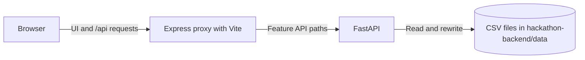

# Quality Matrix

Quality Matrix is a React application and FastAPI API for product information,
solution tracking, PYPCS quality submissions, action items, and chat. The API
uses files in `hackathon-backend/data` rather than a database; the browser
reaches it through the frontend's Express proxy.

## Repository Layout

```text
TheMatrix/
|-- docker-compose.yaml       # Container service and port configuration
|-- hackathon-backend/        # FastAPI application, configuration, and CSV data
|-- hackathon-frontend/       # React/Vite client and Express API proxy
`-- README.md                 # Project setup and architecture
```

The backend's `app/routers` defines API endpoints, and `app/services` contains
feature logic. The frontend separates its React code in `src/client` from its
Express proxy in `src/server`.

## Architecture



Express listens on port 5173 in local development. The frontend proxy target
uses `DJANGO_BASE_URL` as its environment-variable name, but the target service
is this FastAPI backend on port 8004.

The frontend instructions describe a Django target and say `forwardRequest`
adds `/api`; current code mounts `/api` in Express and appends the supplied
backend path directly to the configured base URL.

## Prerequisites

- Python 3.12+.
- Node.js LTS and npm. `package.json` does not specify a Node engine version.
- Windows PowerShell for the commands below.

## Run locally (Windows)

### First-time setup

```powershell
cd hackathon-backend
py -3.12 -m venv .venv
# If `py -3.12` is unavailable, use: python -m venv .venv
.\.venv\Scripts\python.exe -m pip install -r requirements.txt
```

Install frontend dependencies and create `hackathon-frontend/.env.development`
with the variable names `PORT`, `NODE_ENV`, `DJANGO_BASE_URL`, and
`VITE_ENCRYPTION_KEY`. Set `DJANGO_BASE_URL` to the backend URL, normally
`http://127.0.0.1:8004`. Keep any encryption key value private.

```powershell
cd ..\hackathon-frontend
npm install
```

### Every time

Start the backend in the first PowerShell terminal. The local data override
keeps UI edits in `hackathon-backend/data`; without it, the backend uses the
team network share configured in `.env.production`.

```powershell
cd hackathon-backend
$env:QUALITY_MATRIX_DATA_DIR = "data"
.\.venv\Scripts\python.exe -m uvicorn main:app --reload --port 8004
```

Start the frontend in a second terminal:

```powershell
cd hackathon-frontend
npm run dev
```

### Verify

- Backend health: [http://127.0.0.1:8004/health](http://127.0.0.1:8004/health)
- API docs: [http://127.0.0.1:8004/docs](http://127.0.0.1:8004/docs)
- UI: [http://localhost:5173](http://localhost:5173)

If PowerShell's `Invoke-WebRequest` reports a proxy error for localhost, test
with `curl.exe --noproxy "*" http://127.0.0.1:8004/health`.

### Docker Compose

Compose runs the frontend on port 8005 and the backend on port 8004. Both
Dockerfiles are present. Data is baked into the backend image from
`hackathon-backend/data`, so a fresh deploy needs no external share. To use the
network share instead, uncomment the `volumes` entry for the backend in
`docker-compose.yaml` (`/mnt/x/Quality:/app/data`).

Compose only reads `${...}` values from the shell or `--env-file`, not from
`.env.production` automatically. Create the root `.env.production` from
`.env.example` (it is gitignored), then run:

```bash
docker compose --env-file .env.production up -d --build
```

Both services also receive `.env.production` values through `env_file`, which is
optional. The backend skips the Intel CA install when `intel-ca.crt` is not in
its build context.

NYRA chat is enabled when `NYRA_API_KEY` is set in the root `.env.production`.
The backend image installs `nyra-services` from `NYRA_PACKAGE_URL` (the Intel
git repository) at build time; set it empty on hosts without Intel network
access, which disables the chat endpoint.

Inside Docker, the admin account is created from `QUALITY_MATRIX_ADMIN_USERNAME` and `QUALITY_MATRIX_ADMIN_PASSWORD` in the host's `.env.production` only when `data/Auth/Users.csv` has no active admin; `data/Auth` is git-ignored but is copied into the backend image, and `QUALITY_MATRIX_AUTH_SECRET` keeps tokens valid across restarts.

## Configuration

| Variable                                                     | File or source                             | Purpose                                                                                                                                                                                                 |
| ------------------------------------------------------------ | ------------------------------------------ | ------------------------------------------------------------------------------------------------------------------------------------------------------------------------------------------------------- |
| `PORT`                                                     | Frontend `.env.development`              | Express listen port; local setting is 5173.                                                                                                                                                             |
| `DJANGO_BASE_URL`                                          | Frontend `.env.development`              | FastAPI base URL; local setting is `http://127.0.0.1:8004`. The name is legacy.                                                                                                                       |
| `NODE_ENV`                                                 | Frontend `.env.development` / npm script | Selects development or production mode and env file.                                                                                                                                                    |
| `COOKIE_SECURE`                                            | Frontend environment / root `.env.production` | Sets the `Secure` flag on the `qm_token` cookie: `true` or `false`. Unset defaults to `true` when `NODE_ENV=production`. Compose defaults to `false`; set `true` once served over HTTPS. |
| `VITE_ENCRYPTION_KEY`                                      | Frontend `.env.development`              | Loaded into server config; keep any value private.                                                                                                                                                      |
| `VITE_API_BASE_URL`                                        | Frontend `.env.development`              | Present in the env file; no consumer was found in current source.                                                                                                                                       |
| `QUALITY_MATRIX_DATA_DIR`                                  | Backend `.env.production` or shell       | `.env.production` sets the team network share location. Defaults to `data`; for local data, set `$env:QUALITY_MATRIX_DATA_DIR = "data"` in the backend PowerShell window before starting Uvicorn. |
| `ALLOWED_ORIGINS`                                          | Backend environment                        | Comma-separated browser origins; defaults include ports 5173 and 3000.                                                                                                                                  |
| `QUALITY_MATRIX_LOG_LEVEL`                                 | Backend environment                        | Log level for the `app` logger (stderr); default `INFO`, invalid values fall back to `INFO`. Logged PdO emails appear at `INFO`.                                                                       |
| `NYRA_API_KEY`                                             | Backend `.env.production`                | Required by the chat endpoint; secret.                                                                                                                                                                  |
| `NYRA_CHAT_MODEL`                                          | Backend `.env.production`                | Optional chat model override; code default is `deepseek-v4.1-flash`.                                                                                                                                  |
| `NYRA_PACKAGE_URL`                                         | Backend Docker build                     | Git URL the backend image installs `nyra-services` from; set empty to skip the install (chat then returns a clean error).                                                                             |
| `QUALITY_MATRIX_PUBLIC_URL`                                | Backend `.env.production`                | Base URL for review links in PdO emails; default `http://localhost:5173`. Production: `http://quality-matrix-vnat.intel.com`.                                                                           |
| `QUALITY_MATRIX_MAIL_TRANSPORT`                            | Backend `.env.production`                | PdO email transport: `outlook` (desktop Outlook COM, needs pywin32), `smtp`, or `log`. Unset defaults to `smtp` when `QUALITY_MATRIX_SMTP_HOST` is set, else `outlook` on Windows, else `log`. Log-mode output is logged at `WARNING`. |
| `QUALITY_MATRIX_MAIL_ENABLED`, `QUALITY_MATRIX_MAIL_FROM`  | Backend `.env.production`                | Final-submit PdO emails; default enabled, sender `no-reply@localhost` (submitter's email is used as sender when present). `QUALITY_MATRIX_MAIL_ENABLED=false` forces `log` transport. |
| `QUALITY_MATRIX_SMTP_HOST`, `_PORT`, `_STARTTLS`, `_USERNAME`, `_PASSWORD` | Backend `.env.production`                | SMTP relay for PdO emails; port default 25, STARTTLS default false, username/password optional (secret).                                                                                              |
| `HTTP_PROXY`, `HTTPS_PROXY`, `FTP_PROXY`, `NO_PROXY` | Root `.env.production`                   | Optional proxy settings passed to the Compose builds and containers.                                                                                                                                    |

The frontend env file also contains `VITE_ENCRYPTION_KEY`; do not put its value
in documentation or commit sensitive values. Compose reads the root
`.env.production`, which is separate from the backend's `.env.production`.

## Troubleshooting

| Symptom                                                                   | Cause                                                                              | Fix                                                                                                                                                                                                                                       |
| ------------------------------------------------------------------------- | ---------------------------------------------------------------------------------- | ----------------------------------------------------------------------------------------------------------------------------------------------------------------------------------------------------------------------------------------- |
| `Activate.ps1` is blocked                                               | PowerShell execution policy prevents script activation.                            | From `hackathon-backend`, use `.\.venv\Scripts\python.exe` directly as shown above. Or run `Set-ExecutionPolicy -Scope Process -ExecutionPolicy Bypass` in that window only, then activate.                                         |
| `python` or `uvicorn` is not found                                    | The venv is missing, or a bare command is being used.                              | From `hackathon-backend`, run `.\.venv\Scripts\python.exe -m uvicorn main:app --reload --port 8004`.                                                                                                                                  |
| `ModuleNotFoundError`                                                   | Backend requirements or frontend packages are missing.                             | Backend, from `hackathon-backend`: `.\.venv\Scripts\python.exe -m pip install -r requirements.txt`. Frontend: run `npm install` in `hackathon-frontend`.                                                                          |
| Port 8004 or 5173 is already in use                                       | Another process owns the port.                                                     | Check with `Get-NetTCPConnection -LocalPort 8004` (or `5173`), inspect it with `Get-Process -Id <OwningProcess>`, then stop that process if appropriate. Alternatively, choose another backend port and update `DJANGO_BASE_URL`. |
| Frontend starts, but API calls fail, return 502, or show `ECONNREFUSED` | Backend is not running, or `DJANGO_BASE_URL` is wrong.                           | Start the backend and set `DJANGO_BASE_URL` in `.env.development` to its URL, such as `http://127.0.0.1:8004`.                                                                                                                      |
| Pages are empty or View 2 shows 0 items                                   | Backend is reading the team share, which may not contain local action-item data.   | Set `$env:QUALITY_MATRIX_DATA_DIR = "data"` in the backend terminal before starting Uvicorn.                                                                                                                                            |
| Share reads fail or startup is slow                                       | The team network share is unavailable, for example when off VPN or without access. | Connect to the team network/VPN, or use local data mode above.                                                                                                                                                                            |
| `Invoke-WebRequest` gets 403 for localhost                              | PowerShell request is going through the configured corporate proxy.                | Use `curl.exe --noproxy "*" http://127.0.0.1:8004/health`, or set `$env:NO_PROXY = "localhost,127.0.0.1"` for the session.                                                                                                            |
| `pip install` or `npm install` fails behind the proxy                 | The package client cannot reach its registry through the corporate proxy.          | Configure the approved corporate proxy for pip/npm, then retry the install.                                                                                                                                                               |
| Frontend starts on the wrong port or proxy requests fail                  | `.env.development` is missing or misconfigured; the server may still start.      | Create `hackathon-frontend/.env.development` and define `PORT`, `NODE_ENV`, `DJANGO_BASE_URL`, and `VITE_ENCRYPTION_KEY`.                                                                                                       |
| A command copied from frontend `AGENTS.md` fails                        | Its Routing section contains a malformed pasted command.                           | Do not copy commands from that section; use the commands in this README.                                                                                                                                                                  |
| Final-submit PdO email not sent; startup logs `Mail transport is 'log'` (WARNING) | No SMTP host configured, or `outlook` transport on a non-Windows host. | Set `QUALITY_MATRIX_SMTP_HOST` (plus port, STARTTLS, and credentials if needed) in `.env.production`, then restart. Test delivery with `docker exec -it <backend-container> python -m app.services.notification_service --test-to you@intel.com` (local: `.\.venv\Scripts\python.exe -m app.services.notification_service --test-to you@intel.com`). Exit 0 means sent; exit 1 prints the transport, host:port, and error. The container must reach SMTP on port 25 or 587. Outlook works only with native Windows desktop Outlook. |
| Final submit returns 422 with `field: "product_group_email"` | The Product group email is required for final submission and is empty or invalid. | Enter a valid group or DL email in the Product group email field. Drafts save without it. |

The stale Browserslist data warning at frontend startup is harmless.

## Pages and Data

| Page                                                   | Browser route                      | Backend API                                                                                                                        | Data files                                                                                                                                                                                                                                                                                        |
| ------------------------------------------------------ | ---------------------------------- | ---------------------------------------------------------------------------------------------------------------------------------- | ------------------------------------------------------------------------------------------------------------------------------------------------------------------------------------------------------------------------------------------------------------------------------------------------- |
| TI (STHI / LCBI, hidden in UI)                         | `/ti/sthi`, `/ti/lcbi`         | `/product-basis/{module}` (API kept)                                                                                             | `TI/ProductBasisInfo_STHI.csv`, `TI/ProductBasisInfo_LCBI.csv`                                                                                                                                                                                                                                |
| PdO (STHI / LCBI, hidden in UI)                        | `/pdo/sthi`, `/pdo/lcbi`       | `/product-basis/{module}`, `/pdsolutions/{module}`, `/solutions` (APIs kept)                                                 | `PdO/ProductSolutionMatrix_STHI.csv`, `PdO/ProductSolutionMatrix_LCBI.csv`                                                                                                                                                                                                                    |
| GL-MQR (STHI / LCBI, hidden in UI)                     | `/gl-mqr/sthi`, `/gl-mqr/lcbi` | Solutions API and proxy routes kept                                                                                                | `GL-MQR/Solution.csv`                                                                                                                                                                                                                                                                           |
| Quality Matrix (PYPCS; matrix mode, form mode removed) | `/pypcs`                         | `/pypcs/modules`, `/pypcs/questions`, `/pypcs/submissions`, `/pypcs/matrix-submission`, and related `/pypcs/*` endpoints | `QualityMatrix/PYPCS_Submissions.csv`, `QualityMatrix/PYPCS_SubmissionCells.csv`, `QualityMatrix/Settings/PYPCS_Modules.csv`, `QualityMatrix/Settings/PYPCS_Questions.csv`, `QualityMatrix/Settings/PYPCS_QuestionModuleMap.csv`, `QualityMatrix/Settings/Operation_Process_Step.csv` |
| View 2                                                 | `/view-2`                        | `/pypcs/action-items` and `/pypcs/action-items/options`                                                                        | `View2/PYPCS_ActionItems.csv`                                                                                                                                                                                                                                                                   |
| View 3                                                 | `/view-3`                        | `/pypcs/product-action-matrix`, `/pypcs/product-action-matrix/rows`, `/pypcs/product-action-matrix/export`                   | `View3/PYPCS_ProductActionDecisions.csv` plus Quality Matrix submissions/cells, Quality Matrix module settings, and `View2/PYPCS_ActionItems.csv`                                                                                                                                             |
| Chat                                                   | `/chat`                          | `/chat` (health: `/chat/health`)                                                                                               | Requires an active `NYRA_API_KEY` and `nyra-services` (installed from an Intel git URL, not in `requirements.txt`). Answers are grounded in a live data snapshot; XRB comes from `QUALITY_MATRIX_XRB_PATH` (default `<DATA_DIR>/XRB.csv`). UI built with Ant Design X.                     |

The GL-MQR proxy path and FastAPI route do not currently match; see the API
routers before relying on that page. View 2 supports adding and editing action
items; it does not currently provide delete behavior.

## Data Notes

CSV files under `hackathon-backend/data` are the source of truth for the
features above. Updates rewrite the corresponding CSV file, so back up the data
before bulk edits. The API has no authentication by design; run it only in an
appropriate trusted environment.

### Network share data

When `QUALITY_MATRIX_DATA_DIR` is not overridden, the backend reads the share
configured in `hackathon-backend/.env.production`:
`\\VNATSHFS.intel.com\VNATAnalysis$\MAOATM\VN\Applications\TE\Quality`.
Data is grouped by owning tab: `QualityMatrix/PYPCS_Submissions.csv`,
`QualityMatrix/PYPCS_SubmissionCells.csv`, and `QualityMatrix/Settings/` for
modules, questions, question/module mappings, and operation steps;
`View2/PYPCS_ActionItems.csv`; `View3/PYPCS_ProductActionDecisions.csv`;
`TI/ProductBasisInfo_STHI.csv` and `TI/ProductBasisInfo_LCBI.csv`;
`PdO/ProductSolutionMatrix_STHI.csv` and `PdO/ProductSolutionMatrix_LCBI.csv`;
and `GL-MQR/Solution.csv`. TI, PdO, and GL-MQR are hidden in the UI, but their
data and APIs remain supported. At startup, the backend rejects any of the old
data files left directly in the share root.

### Migrate data layout

Stop the backend before migrating. From `hackathon-backend`, preview first,
then apply; the default backup is created under the data directory with a UTC
timestamp. Start the backend again after migration.

```powershell
cd hackathon-backend
.\.venv\Scripts\python.exe scripts\migrate_data_layout.py --data-dir "\\VNATSHFS.intel.com\VNATAnalysis$\MAOATM\VN\Applications\TE\Quality"
.\.venv\Scripts\python.exe scripts\migrate_data_layout.py --data-dir "\\VNATSHFS.intel.com\VNATAnalysis$\MAOATM\VN\Applications\TE\Quality" --apply
```

## View 3

View 3 merges the latest submission for each product with all View 2 actions,
groups selected modules, and suggests status from package compatibility. Only
decisions and their identifying labels are stored in
`View3/PYPCS_ProductActionDecisions.csv`; orphaned decisions are retained when
source products or actions are removed.

## Further Documentation

- [Backend instructions](hackathon-backend/AGENTS.md)
- [Frontend instructions](hackathon-frontend/AGENTS.md)
- [Frontend README](hackathon-frontend/README.md)
